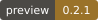
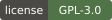
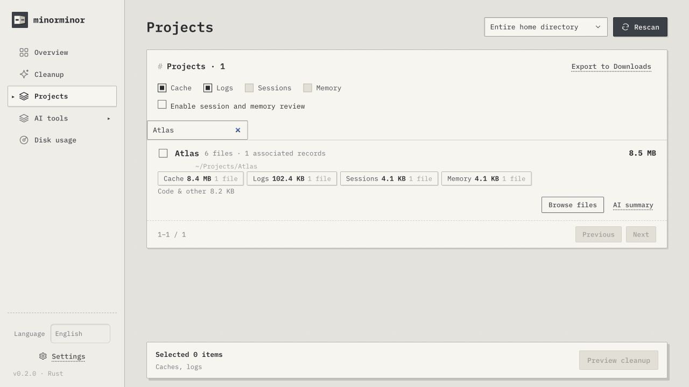

<p align="center"></p>
<h1 align="center">Minorminor Rust Application</h1>
<p align="center"><strong>See what takes space. Choose what goes.</strong><br />A standalone macOS app: Rust backend, WebKit window and file-by-file review.</p>

<p align="center">
  <a href="native/Cargo.toml"></a>
  <a href="docs/desktop.en.md#requirements"></a>
  <a href="native/Cargo.toml"></a>
  <a href="LICENSE"></a>
  <a href="https://github.com/Ray-hola/Minorminor-Rust/actions/workflows/ci.yml"></a>
</p>
<p align="center"><a href="README.md">简体中文</a> · <strong>English</strong> · <a href="https://github.com/Ray-hola/Minorminor">Web edition</a></p>
<p align="center">Integrates the <a href="https://github.com/tw93/Mole">Mole</a> submodule · Thanks to <a href="https://github.com/tw93">Tw93</a> and contributors</p>
<p align="center"><a href="#get-started">Get started</a> · <a href="docs/desktop.en.md">User guide</a> · <a href="#development-and-builds">Development</a></p>


<p align="center"><sub>Actual Rust interface with isolated sample projects and files.</sub></p>

## What it does

- Scan in the background and update folder sizes, file categories, projects and AI tool discovery together.
- Expand folders and files; inspect caches, logs, sessions, memory, purpose and storage.
- Select a scope, review individual files, choose Trash or explicitly confirm permanent deletion, and retain per-file receipts.
- Discover AI tools from installation and directory evidence; optionally review metadata in AI batches or summarize selected files.
- Use Mole lists or full cleanup, JSON / CSV exports and imported Web history.

This repository independently maintains the **Rust Application**. The [Minorminor Web edition](https://github.com/Ray-hola/Minorminor) has a Node.js backend and separate entry points, APIs, records and versions.

## Get started

**[Download v0.2.0 preview · Apple Silicon](https://github.com/Ray-hola/Minorminor-Rust/releases/download/v0.2.0/Minorminor-v0.2.0-macos-arm64.zip)**. Unzip and drag `Minorminor.app` into Applications. Ad-hoc signed, not notarized; see [release notes and checksums](https://github.com/Ray-hola/Minorminor-Rust/releases/tag/v0.2.0).

Source builds require **macOS 12+, Git, Rust 1.88+ and Xcode Command Line Tools**.

```sh
git clone --recurse-submodules https://github.com/Ray-hola/Minorminor-Rust.git
cd Minorminor-Rust
./scripts/run-native.sh
```

You can also double-click **`start.command`**. The first launch compiles the source. A built `.app` needs neither Node.js nor Rust at runtime, and no global Mole installation.

**Scan → browse → select → preview and confirm.** Choose Simplified Chinese or English in the sidebar. File names, paths, content and model responses retain their original language.

This is the **v0.2.0 development preview**. See the [user guide](docs/desktop.en.md) for requirements, access and stored records. Local builds are ad-hoc signed, without Apple Developer ID signing or notarization.

## Cleanup and AI

Trash is the default. Permanent deletion and full Mole clean require separate explicit confirmation. Four Mole previews, selectable cache / log lists and per-file receipts are available. Sessions and memory require a separate opt-in; recent, busy, protected or changed files are skipped.

AI analysis uses reviewed metadata only; document reading and tool invocation remain disabled. AI summaries sample only a scope you select and confirm. Models cannot select or clean files automatically.

## Development and builds

| Location | Responsibility |
| --- | --- |
| [`native/`](native/) | Rust scanner, SQLite index, cleanup, AI APIs and desktop window |
| [`public/`](public/) | Desktop interface, styles and language catalog |
| [`scripts/`](scripts/) | Launch, packaging, Mole protection and temporary-fixture validation |
| [`vendor/mole/`](https://github.com/tw93/Mole/tree/6650d0958282aa8052cd2bfeee15f67b17fe613b) | Pinned Mole submodule |

```sh
cargo test --locked --manifest-path native/Cargo.toml --no-default-features
./scripts/build-macos.sh
node --test native/tests/progress.test.mjs
python3 scripts/test-native-smoke.py
python3 scripts/test-native-parity.py
```

The build creates `dist/Minorminor.app`. Both Python 3 checks test the packaged app. GitHub Actions runs the same tests, packaging and smoke checks on macOS. Build artifacts are available from [Actions](https://github.com/Ray-hola/Minorminor-Rust/actions); they are not formal Release installers.

Update relevant tests and both language guides with changes; follow the [contribution and sync conventions](docs/desktop.en.md#contributions-and-synchronization). This repository maintains its own versions and releases. Report problems through [Issues](https://github.com/Ray-hola/Minorminor-Rust/issues).

## Upstream, license and thanks

Minorminor Rust Application is licensed under [GNU GPL-3.0](LICENSE) (`GPL-3.0-only`). IBM Plex fonts retain the [SIL Open Font License 1.1](public/fonts/OFL.txt).

This project includes **Mole as a Git submodule** at `vendor/mole/` for cleanup previews, full clean execution and path protection.

- **Mole project: [https://github.com/tw93/Mole](https://github.com/tw93/Mole)**
- Pinned commit and provenance: [UPSTREAM.json](UPSTREAM.json). Upstream code is unchanged, with its [GPL-3.0 license](https://github.com/tw93/Mole/blob/6650d0958282aa8052cd2bfeee15f67b17fe613b/LICENSE) and copyright notices preserved.

Thank you to **[Tw93](https://github.com/tw93)** and **[all Mole contributors](https://github.com/tw93/Mole/graphs/contributors)**. This project originated as the Rust desktop implementation of [Minorminor](https://github.com/Ray-hola/Minorminor) and is now maintained independently.

See the [migration and verification checklist](docs/native-parity.en.md) for tested workflows and remaining hardware validation limits.
