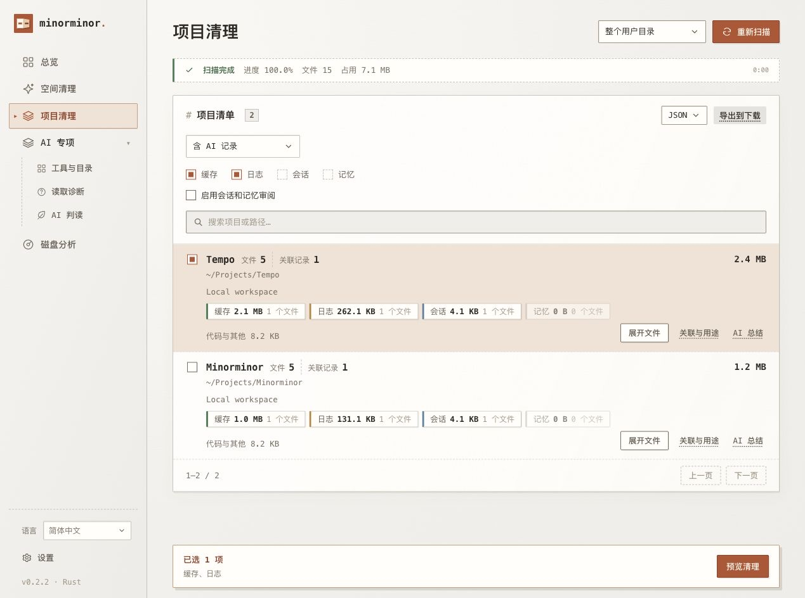

<p align="center"></p>
<h1 align="center">Minorminor Rust Application</h1>
<p align="center"><strong>看清占用，再决定清理。</strong><br />独立的 macOS 桌面应用：Rust 后端，WebKit 窗口，逐文件预览与确认。</p>

<p align="center">
  <a href="native/Cargo.toml"></a>
  <a href="docs/desktop.md#运行要求"></a>
  <a href="native/Cargo.toml"></a>
  <a href="LICENSE"></a>
  <a href="https://github.com/Ray-hola/Minorminor-Rust/actions/workflows/ci.yml"></a>
</p>
<p align="center"><strong>简体中文</strong> · <a href="README.en.md">English</a> · <a href="https://github.com/Ray-hola/Minorminor">Web 版</a></p>
<p align="center">集成 <a href="https://github.com/tw93/Mole">Mole</a> 子模块 · 感谢 <a href="https://github.com/tw93">Tw93</a> 与贡献者</p>
<p align="center"><a href="#开始使用">开始使用</a> · <a href="docs/desktop.md">使用说明</a> · <a href="#开发与构建">开发与构建</a></p>


<p align="center"><sub>实际 Rust 界面，使用独立的示例项目与文件。</sub></p>

[设置界面预览](assets/readme/settings.jpg)

## 可以做什么

- 后台扫描，同步更新目录大小、文件分类、项目与 AI 工具识别。索引无损压缩、后台原子更新，目录重新计量仅保存增量；旧索引自动升级。详见[索引存储](docs/index-storage.md)。
- 展开目录与文件，区分缓存、日志、会话和记忆，查看用途与占用。
- 勾选范围、逐文件预览，选择移到废纸篓或明确确认永久删除，保留逐文件记录。
- 安装信息与目录结构自动发现 AI 工具；可选 AI 分批判读，文件总结由你确认后发起。
- Mole 可视化清单和整次清理，JSON / CSV 导出及 Web 历史导入。

本仓库独立维护 **Rust Application 版**；[Minorminor Web 版](https://github.com/Ray-hola/Minorminor)使用 Node.js 后端，有各自的启动入口、接口、记录与版本。

## 开始使用

**[下载 v0.2.2 预览版 · Apple Silicon](https://github.com/Ray-hola/Minorminor-Rust/releases/download/v0.2.2/Minorminor-v0.2.2-macos-arm64.zip)**。解压后将 `Minorminor.app` 拖入「应用程序」。仅 ad-hoc 签名，尚未公证；[发布说明与校验值](https://github.com/Ray-hola/Minorminor-Rust/releases/tag/v0.2.2)。

源码运行需要 **macOS 12+、Git、Rust 1.88+ 和 Xcode Command Line Tools**。

```sh
git clone --recurse-submodules https://github.com/Ray-hola/Minorminor-Rust.git
cd Minorminor-Rust
./scripts/run-native.sh
```

也可以双击 **`start.command`**。首次启动会编译源码。已构建的 `.app` 无需 Node.js 或 Rust 运行环境，也无需全局安装 Mole。

**扫描 → 展开查看 → 勾选范围 → 预览并确认。** 侧栏可切换简体中文 / English；文件名、路径、内容和模型回复保留原文。

当前为 **v0.2.2 开发预览**。运行要求、权限与记录位置见 [使用说明](docs/desktop.md)；本机构建仅做 ad-hoc 签名，未经过 Apple Developer ID 签名或公证。

## 清理与 AI

默认将审阅后的文件移到废纸篓；永久删除和整次 Mole clean 需要单独明确确认。支持 Mole 四种命令预览、按清单勾选缓存与日志、逐文件操作记录。会话和记忆需要另行启用，近期、正在使用、受保护或身份已变化的文件会跳过。

AI 判读只使用经审阅的元数据，文档读取和工具调用权限固定禁用。「AI 总结」只对你点选并确认的范围抽读。模型不能自动勾选或执行清理。

## 开发与构建

| 目录 | 职责 |
| --- | --- |
| [`native/`](native/) | Rust 扫描、SQLite 索引、清理、AI 接口与桌面窗口 |
| [`public/`](public/) | 桌面界面、样式和中英文文案 |
| [`scripts/`](scripts/) | 启动、打包、Mole 保护适配与临时样例验证 |
| [`vendor/mole/`](https://github.com/tw93/Mole/tree/6650d0958282aa8052cd2bfeee15f67b17fe613b) | 固定版本的 Mole 子模块 |

```sh
cargo test --locked --manifest-path native/Cargo.toml --no-default-features
./scripts/build-macos.sh
node --test native/tests/progress.test.mjs
python3 scripts/test-native-smoke.py
python3 scripts/test-native-parity.py
```

构建生成 `dist/Minorminor.app`，两项 Python 3 测试验证打包应用。GitHub Actions 在 macOS 上运行相同测试、打包与冒烟验证，构建产物可从 [Actions](https://github.com/Ray-hola/Minorminor-Rust/actions) 获取；它们不等于正式 Release 安装包。

功能迁移与逐项验证见 [验证清单](docs/native-parity.md)，提交与同步遵循 [维护约定](docs/desktop.md#贡献与同步)。修改功能时同步相关测试与双语说明；发布与版本各自在本仓库维护。反馈入口：[Issues](https://github.com/Ray-hola/Minorminor-Rust/issues)。

## 上游、许可与致谢

Minorminor Rust Application 采用 [GNU GPL-3.0](LICENSE)（`GPL-3.0-only`）。IBM Plex 字体保留 [SIL Open Font License 1.1](public/fonts/OFL.txt)。

本项目将 **Mole 作为 Git 子模块**引入 `vendor/mole/`，提供清理预览、整次 clean 执行与路径保护能力。

- **Mole 项目网址：[https://github.com/tw93/Mole](https://github.com/tw93/Mole)**
- 固定提交与来源：[UPSTREAM.json](UPSTREAM.json)。上游代码保持原样，保留其 [GPL-3.0 许可证](https://github.com/tw93/Mole/blob/6650d0958282aa8052cd2bfeee15f67b17fe613b/LICENSE)与版权信息。

感谢作者 **[Tw93](https://github.com/tw93)** 与 **[Mole 的所有贡献者](https://github.com/tw93/Mole/graphs/contributors)**。本项目源自 [Minorminor](https://github.com/Ray-hola/Minorminor) 的 Rust 桌面实现，现独立维护。
